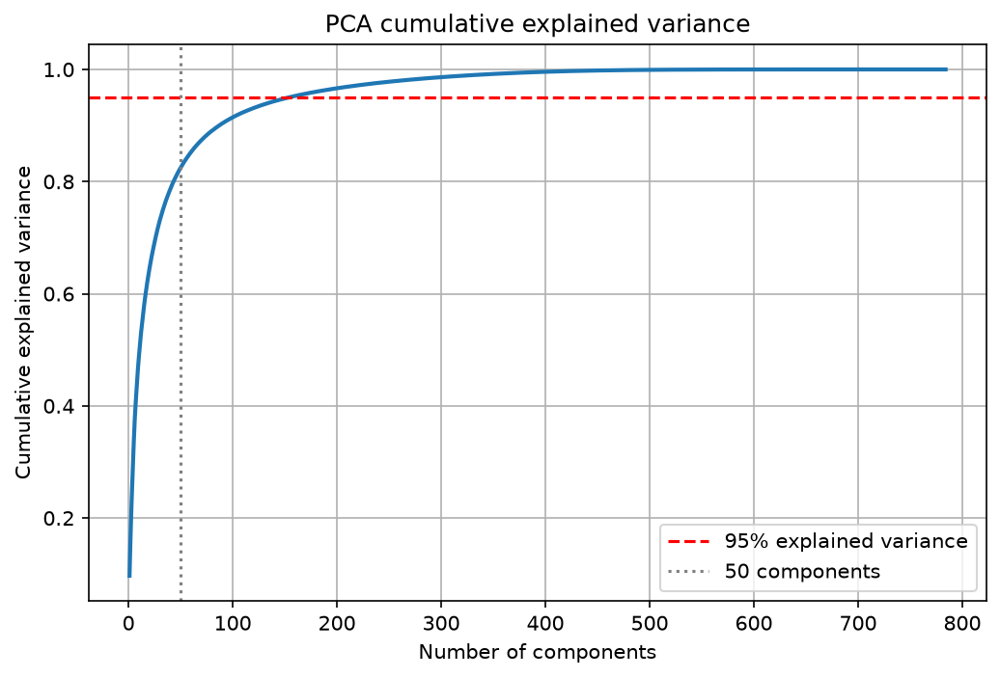
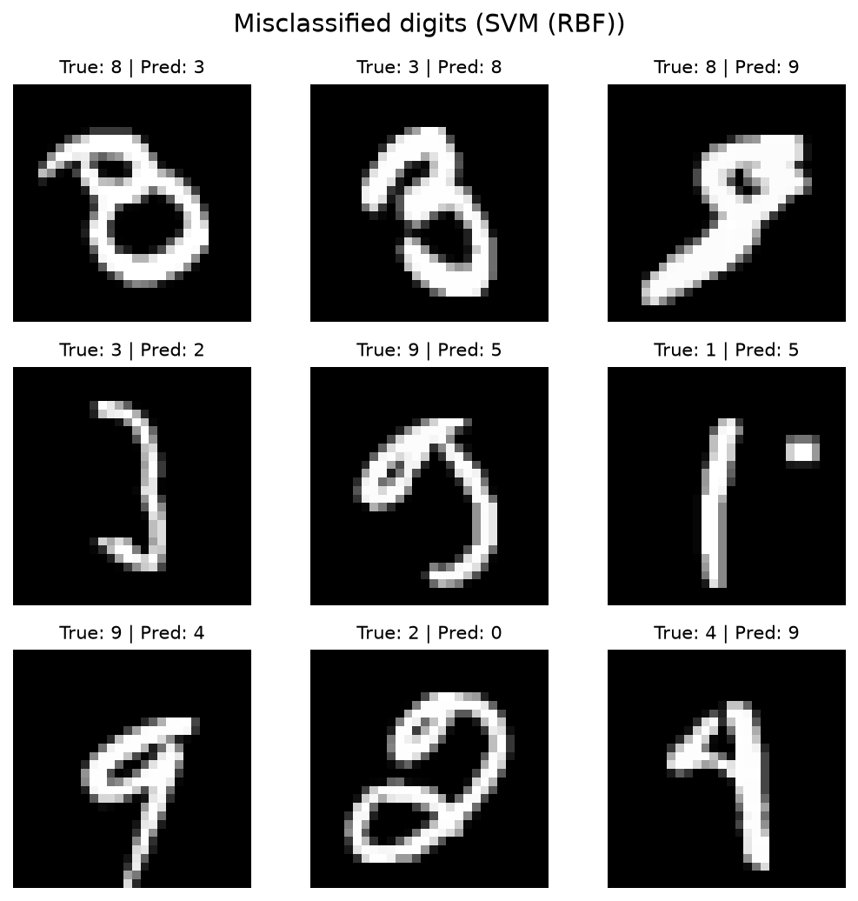
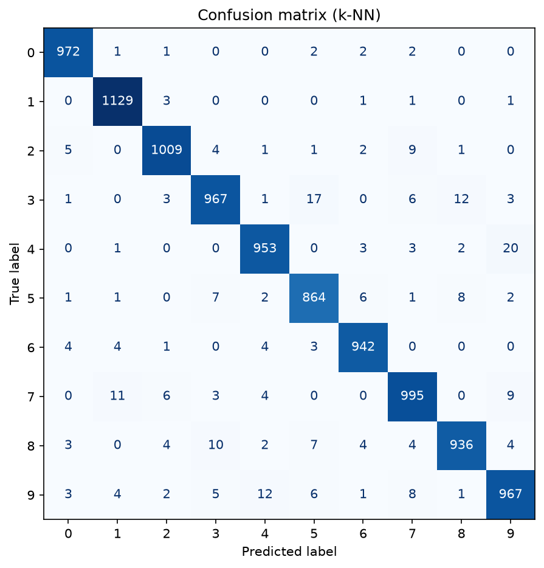
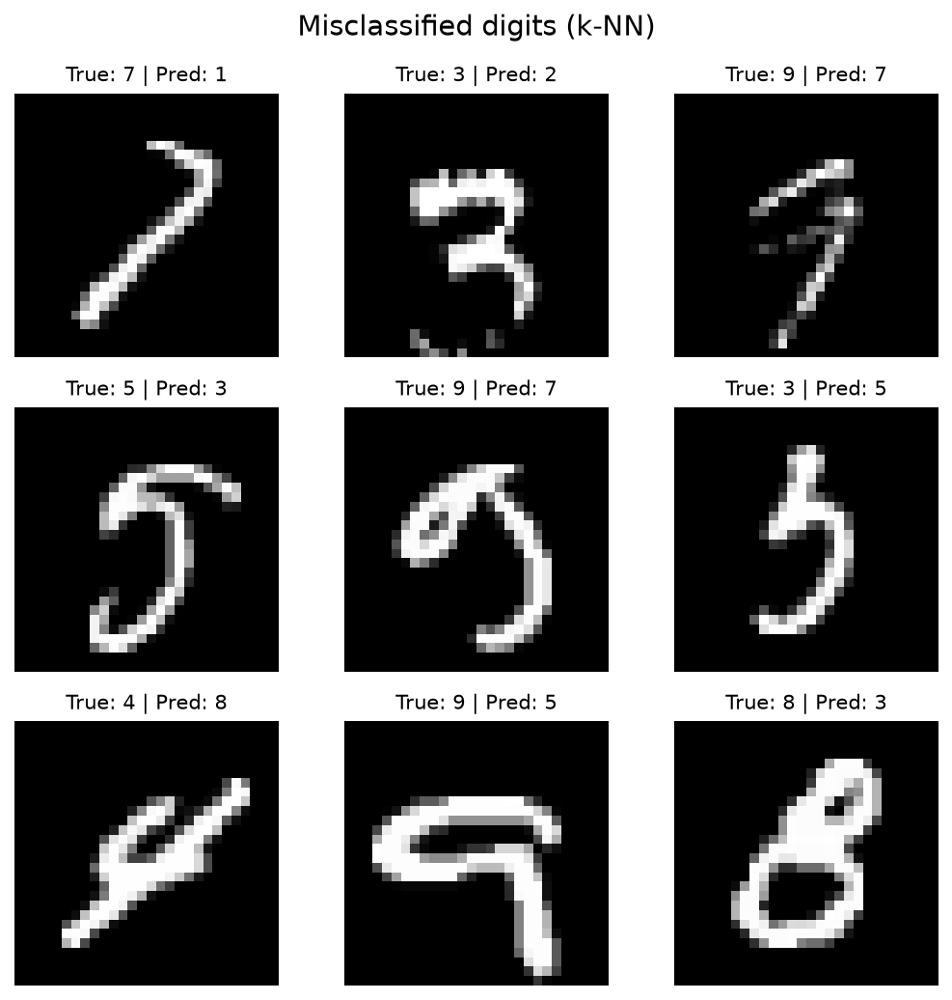
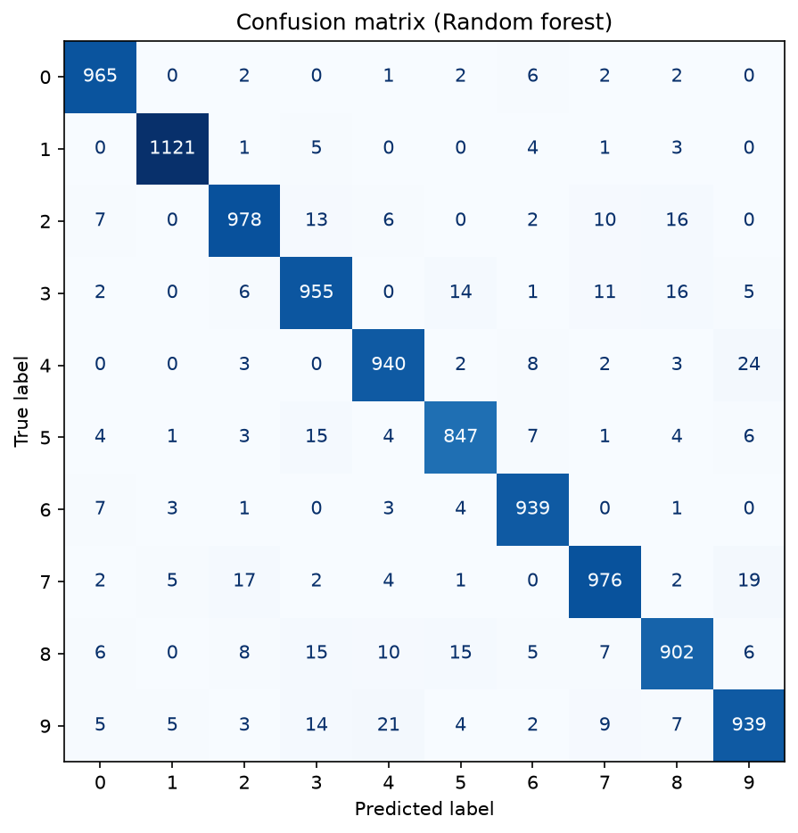
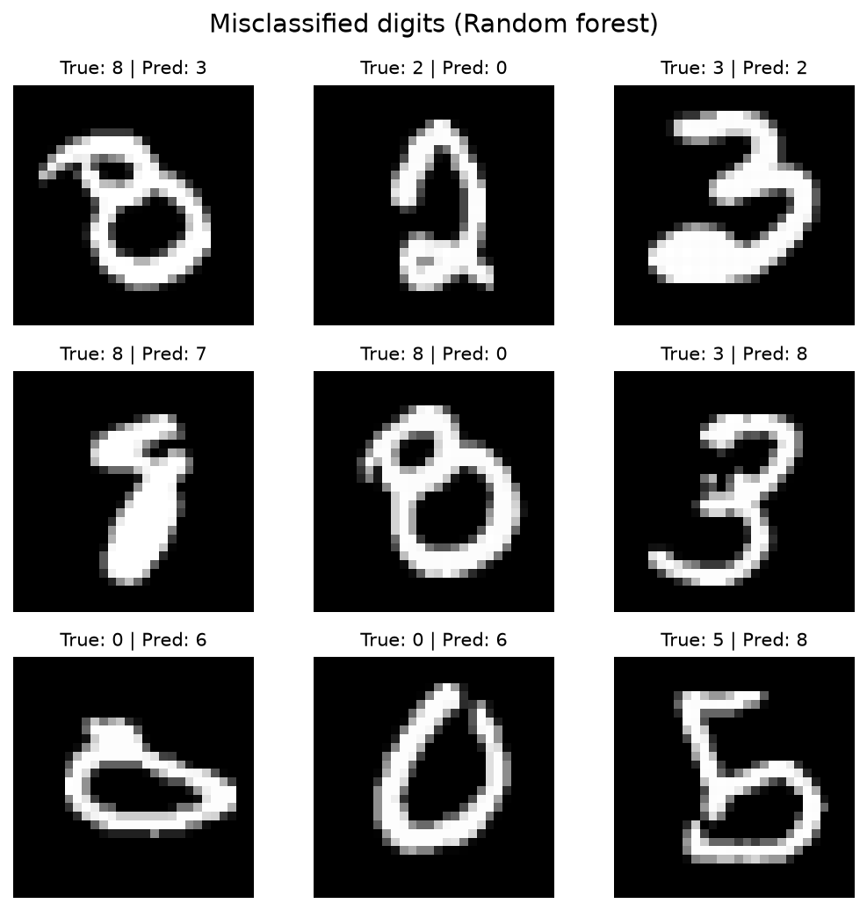
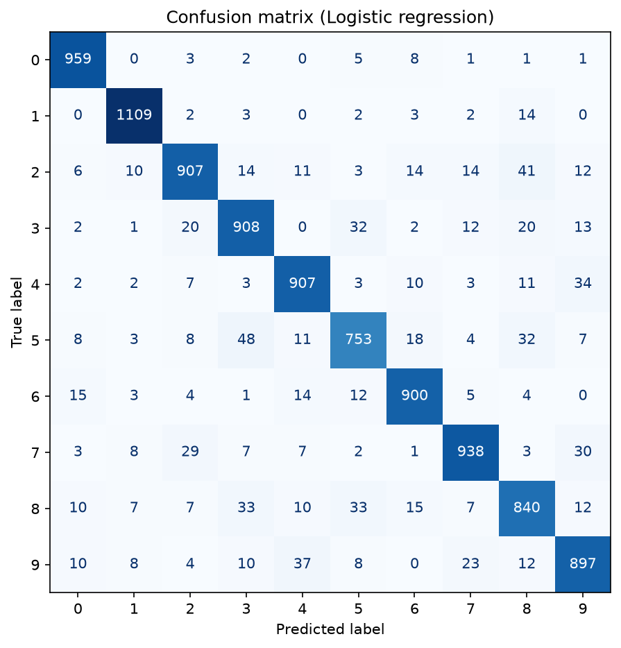
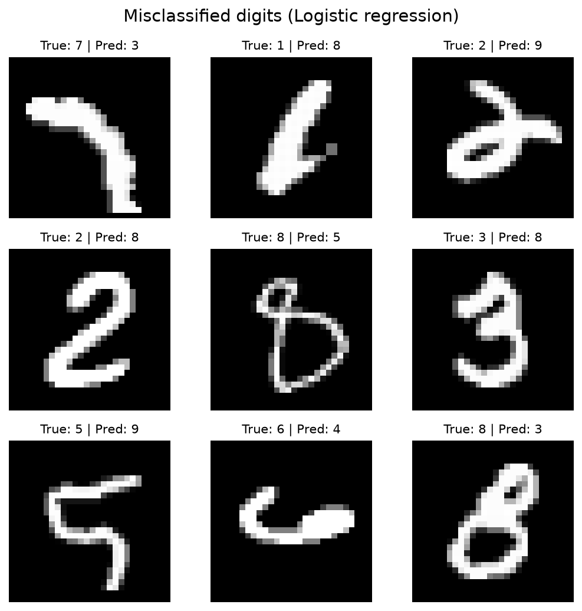

# mnist-digit-classifier

Handwritten digit classification (0-9) on MNIST with scikit-learn. Four classical models are trained on the same PCA-reduced features and compared on accuracy, speed, and the mistakes they make. The best model can also classify a photo of your own handwriting.

**Best result: 98.68% test accuracy with an RBF-kernel SVM on 50 PCA components, trained in 16 seconds on a desktop CPU.**

## Results

All models use the standard 60,000 / 10,000 train/test split, pixels scaled to [0, 1], and PCA to 50 components. Hyperparameters were chosen with 3-fold `GridSearchCV` on a random 10,000-image subset, then each model was refit on the full training set.

| Model | Test accuracy | Train time | Predict time (10k) | Selected params |
|---|---|---|---|---|
| **SVM (RBF)** | **98.68%** | 15.9 s | 8.4 s | `C=5`, `gamma="scale"` |
| k-NN | 97.34% | 0.4 s | 0.5 s | `k=1` |
| Random forest | 95.62% | 11.8 s | 0.1 s | 200 trees, no depth limit |
| Logistic regression | 91.18% | 1.6 s | <0.1 s | `C=10` |

Timings from a 16-thread Windows desktop (scikit-learn 1.9, Python 3.13). Full numbers are in [`results/metrics.json`](results/metrics.json).


### Observations

- **The SVM wins on accuracy but is the slowest to predict.** It makes 132 errors on 10,000 test images, spread thinly: its most common mistake (7 read as 2) happens only 8 times.
- **4 and 9 are the classic confusion.** It is the top error pair for k-NN (4→9, 20 times) and random forest (4→9 and 9→4, 45 times combined). Logistic regression struggles most with 5→3 (48) and 2→8 (41), which a linear boundary in pixel space can't separate well.
- **Tuning on a subset can mislead.** On 10k images the grid search picked `k=1` for k-NN, but on the full training set the untuned `k=3` scores slightly higher (97.52% vs 97.34%). With 6× more data, neighbours are denser and averaging over three helps.
- **PCA to 50 components keeps 82.5% of the variance** (95% needs 154), yet costs the SVM almost nothing in accuracy while making both SVM and k-NN much faster.



<details>
<summary>Other confusion matrices and misclassified examples</summary>

| | Confusion matrix | Misclassified samples |
|---|---|---|
| SVM |  |  |
| k-NN |  |  |
| Random forest |  |  |
| Logistic regression |  |  |

Many of the SVM's errors are digits a person would also hesitate on: an 8 and a 3 that look like each other, a 3 drawn as a bare bracket, a 1 with a stray mark beside it, a 4 with a closed top that reads as a 9.

</details>

## Classifying your own handwriting

MNIST digits are light strokes on a black background, scaled to fit a 20×20 box and centred by centre of mass inside a 28×28 frame. A phone photo looks nothing like that, so [`src/predict.py`](src/predict.py) reproduces the same steps before predicting:

1. Convert to grayscale and invert (dark ink becomes bright)
2. Zero out faint background noise and crop to the ink
3. Pad to a square, resize to 20×20, and place in a 28×28 canvas
4. Shift so the centre of mass is in the middle, scale to [0, 1], flatten to 784 values

Skipping the crop and centring step is the most common reason a model that scores 98% on MNIST gets a hand-drawn digit wrong.

```bash
python -m src.predict --image my_digit.png
# Predicted digit: 7
```

Use `--no-invert` if the image is already light-on-dark, and `--model` to pick a different trained model.

## Reproducing

```bash
pip install -r requirements.txt
python -m src.train --model all --pca 50 --tune   # trains 4 models in a few minutes
python -m src.evaluate                            # figures + metrics in results/
```

The dataset (~55 MB) downloads on first run from OpenML, with a fallback to the `mnist.npz` mirror, and is cached under `~/scikit_learn_data`. Trained models are saved to `models/` and are not committed. Omit `--tune` to train with the default hyperparameters in `src/train.py`.

## Project layout

```
mnist-digit-classifier/
├── src/
│   ├── data.py        # download, scale, split
│   ├── train.py       # PCA + model pipelines, optional grid search, saves models
│   ├── evaluate.py    # accuracy, confusion matrices, misclassified grids
│   └── predict.py     # MNIST-style preprocessing for custom images
├── notebooks/
│   └── 01_exploration.ipynb   # class balance, sample digits, PCA variance
├── results/           # figures and metrics.json
└── requirements.txt
```

## Tech

Python, scikit-learn, NumPy, matplotlib, Pillow, joblib.

## License

[MIT](LICENSE)
